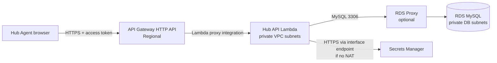

# Hub Agent API Integration Workshop

Hands-on build guide for displaying the existing RDS MySQL data in the Hub Agent React SPA. It uses the project files `db_commands.py`, `mysql_client.py`, `settings.py`, and `intake_prompt.md`, plus the supplied ERD, as implementation context. The prompt and code are context, not instructions to expose database data or run agent logic from the browser.

## What we are building

The Hub Agent browser will call a Regional API Gateway HTTP API. API Gateway invokes a Python Lambda. Lambda reads or updates the private RDS MySQL database and returns a small business-level JSON response. Existing intake/assessment/routing processing continues to write records; this Hub API is the UI's controlled read and action layer.



**Important request direction:** browser → API Gateway → Lambda → RDS. Lambda does not call API Gateway to send the response back. API Gateway returns the Lambda proxy response to the browser. Never connect the browser directly to RDS.

## Gateway or VPC endpoint?

Use a **Regional API Gateway HTTP API** for the Hub Agent SPA. It provides the browser-facing HTTPS endpoint, routes, Lambda integration, CORS, and JWT authorization. Keep the database private by putting the Lambda function in the VPC and allowing only its security group to reach the DB or proxy on TCP 3306. API Gateway invokes Lambda through the Lambda integration; this design does **not** need an API Gateway VPC Link. The Lambda's VPC attachment is the part that gives it network access to RDS.

A **VPC endpoint is not an alternative to API Gateway**. It privately connects resources inside a VPC to a supported AWS service. Add a Secrets Manager interface endpoint if a Lambda in private subnets has no NAT route and needs to retrieve its DB secret. For browser access, a private API plus an `execute-api` interface endpoint is only appropriate when every client is on the VPC or connected through VPN/Direct Connect; an ordinary user's internet browser cannot reach that endpoint. API Gateway private APIs are REST APIs, so do not select one for this public SPA unless that client-network condition is true.

| Choice | Use it for this workshop? | If missing / wrong choice |
|---|---|---|
| Regional HTTP API | **Yes**, browser entry point | Without it, the browser has no authenticated HTTPS API layer to call. |
| Lambda VPC attachment | **Yes**, private DB access | Lambda cannot route to a private RDS address; calls usually time out. |
| Secrets Manager interface VPC endpoint | If Lambda has no NAT and fetches Secrets Manager | Secret retrieval cannot reach the service. Add the endpoint or deliberately provide NAT egress. |
| `execute-api` VPC endpoint + private API | **No** for a normal internet-facing SPA | External browsers cannot reach a private API; it does not create a public API or a database connection. |
| RDS Proxy | Optional for first small-scale slice; recommended as concurrency grows | Direct Lambda connections can exhaust MySQL connections during bursts. Proxy pools connections; it does not fix slow queries or incorrect limits. |

## Workshop map

1. Confirm the schema and separate the current writer from the UI API.
2. Secure DB credentials and create a least-privilege API database user.
3. Prepare VPC subnets and security groups.
4. Create the secret and Lambda execution role.
5. Build and deploy the read-only Hub API Lambda.
6. Create API Gateway routes, JWT authorization, and CORS.
7. Test the endpoint, then connect the SPA.
8. Add Hub Agent write actions safely.

## Before you start: inspect what the existing files do

- `db_commands.py` is a repository for **processing-agent writes and reads**: it registers cases and prescriptions, saves assessments, assignments, decisions/context and updates case history. It is not an HTTP Lambda handler and should not be invoked by the browser. Keep its processing workflows distinct from the UI API.
- `mysql_client.py` opens PyMySQL connections from the `settings` module. It is useful as a reference, but it currently commits even reads and opens a new connection per operation. For the API, use one short connection per invocation (or RDS Proxy), close it reliably, and keep queries bounded.
- `settings.py` currently puts DB connection credentials directly in source. **Before deploying, rotate the exposed password and remove credentials from source control.** Store the replacement in Secrets Manager. Do not copy DB credentials into Lambda code or `VITE_*` browser variables.
- `intake_prompt.md` defines validation behavior for intake. It is not the Hub Agent API contract and does not need to run for a GET request.
- There is a schema discrepancy to resolve: `db_commands.py` writes `case_insights`, while the ERD supplied for this task does not show that table. Before using insight data, confirm the live schema. Do not invent that table or its fields in this API.

The ERD includes `case_master`, `case_assessment`, `case_assignments`, `users`, `case_state_history`, `prescriptions`, `quarantine_cases`, `intake_events`, `outcome_labels`, `payer_rule_pack`, `routing_rules`, `drug_access_rules`, `barrier_taxonomy`, `case_decision`, and `override_feedback`. Some labels are clipped: use the live DDL (`SHOW CREATE TABLE ...`) as the source of truth for names, types, indexes, and foreign keys.

## Step 1 — Confirm the live DB schema and API data needs

1. In the RDS console, record the engine/version, Region, VPC, DB subnet group, port, and endpoint. Confirm **Publicly accessible = No**.
2. From an approved administration path, inspect the tables used for the first screen:

   ```sql
   SHOW CREATE TABLE case_master;
   SHOW CREATE TABLE case_assessment;
   SHOW CREATE TABLE case_assignments;
   SHOW CREATE TABLE users;
   SHOW CREATE TABLE prescriptions;
   SHOW CREATE TABLE case_state_history;
   ```

3. Confirm that each table has the keys and timestamps expected by the ERD; check whether `case_assessment.is_current` exists and how “latest assignment” is represented. Verify status/risk values and any existing indexes.
4. Start with a read-only API slice: case queue, case detail, assessment, ownership, and activity. Do not expose `SELECT *`, raw quarantine payloads, full patient data, or the intake prompt.
5. Decide what an authorized Hub Agent may see and do. `assignedTo=me` must be derived from the validated login identity, not accepted as proof from a query string.

## Step 2 — Create the VPC network path

Use the same VPC as RDS. Lambda should use private application subnets with routes to the database subnets. RDS stays in private DB subnets. Use subnets across Availability Zones appropriate to the DB subnet group and availability design.

Create or identify these security groups:

| Security group | Inbound rule | Outbound rule |
|---|---|---|
| `sg-hub-api-lambda` | No inbound rules needed for Lambda invocation | TCP 3306 to DB/proxy SG; HTTPS 443 to endpoint SG if accessing Secrets Manager through an interface endpoint |
| `sg-hub-db` | TCP 3306 **from `sg-hub-api-lambda`** (or proxy SG when using proxy) | Default/required response traffic |
| `sg-hub-rds-proxy` (when used) | TCP 3306 from `sg-hub-api-lambda` | TCP 3306 to `sg-hub-db` |
| `sg-vpce-secrets` (no-NAT setup) | TCP 443 from `sg-hub-api-lambda` | Default/required response traffic |

Do not allow MySQL from `0.0.0.0/0`; do not make RDS public to troubleshoot. Lambda-to-RDS inside the VPC does not need a NAT Gateway. A NAT Gateway is only needed for outbound internet dependencies. To retrieve Secrets Manager privately without NAT, create an **interface** endpoint for Secrets Manager with private DNS enabled and the security-group rule above. In the VPC console, choose **Endpoints → Create endpoint → AWS services**, select the regional `com.amazonaws.<region>.secretsmanager` service, choose the same VPC and private subnets, enable private DNS, associate `sg-vpce-secrets`, then create it. A VPC endpoint for API Gateway is not required for a browser-facing Regional API.

If the VPC has restrictive network ACLs, allow the database and return/ephemeral ports as required by the chosen subnet design. Check route tables, DNS support, NACLs, and security groups if Lambda times out.

## Step 3 — Create a dedicated DB user and store its secret

1. Rotate the credential currently stored in `settings.py`; remove the old credential from source and any checked-in history/working copies as your incident process requires.
2. Create a dedicated application user (not the RDS master/admin user) with only `SELECT` for this first workshop. Grant `INSERT`/`UPDATE` only later, on the specific tables and workflows that need writes.
3. In AWS Secrets Manager, create a secret containing the new database username and password, for example:

   ```json
   {"username":"hub_api_user","password":"REPLACE_WITH_ROTATED_SECRET"}
   ```

4. Record the secret ARN. Put only non-secret configuration in Lambda environment variables: `DB_HOST`, `DB_PORT=3306`, `DB_NAME`, `DB_SECRET_ARN`.
5. If using RDS Proxy, create it in this VPC across private subnets, associate the DB secret, register the DB as its target, and set `DB_HOST` to the proxy endpoint. The Lambda connects as the application DB user.

## Step 4 — Create the Lambda role and function

Create an execution role for `hub-agent-api` with:

- Basic CloudWatch Logs permissions for the function.
- The Lambda VPC network-interface permissions needed to attach to subnets/security groups.
- `secretsmanager:GetSecretValue` scoped to the one DB secret ARN (and `kms:Decrypt` only if that secret uses a customer-managed key).
- No broad administrator policy and no unnecessary write permissions.

Create a Python Lambda function in the same Region. Attach `sg-hub-api-lambda` and the private application subnets. Package `pymysql` in the deployment bundle or a compatible layer, and configure a supported Python runtime and timeout. Set a modest memory/concurrency limit for the first slice. Use RDS Proxy if expected concurrency may otherwise exceed database connection capacity.

### Minimal first route: `GET /cases`

Use the function as an API adapter: validate the route/parameters, run parameterized SQL, map columns to the Hub Agent response, and return an API Gateway proxy response. The following is a workshop skeleton; align the SQL with the live DDL before deploying. It assumes the `case_assessment.is_current` field seen in the ERD and deliberately returns a minimal allow-listed set of fields.

```python
import json
import os
from datetime import date, datetime
from decimal import Decimal
from functools import lru_cache

import boto3
import pymysql
from pymysql.cursors import DictCursor

sm = boto3.client("secretsmanager")

@lru_cache(maxsize=1)
def db_secret():
    result = sm.get_secret_value(SecretId=os.environ["DB_SECRET_ARN"])
    return json.loads(result["SecretString"])

def json_default(value):
    if isinstance(value, Decimal):
        return float(value)
    if isinstance(value, (datetime, date)):
        return value.isoformat()
    raise TypeError(f"Unsupported JSON value: {type(value).__name__}")

def reply(status, payload):
    return {"statusCode": status,
            "headers": {"content-type": "application/json"},
            "body": json.dumps(payload, default=json_default)}

def connect():
    secret = db_secret()
    return pymysql.connect(
        host=os.environ["DB_HOST"], port=int(os.getenv("DB_PORT", "3306")),
        user=secret["username"], password=secret["password"],
        database=os.environ["DB_NAME"], cursorclass=DictCursor,
        charset="utf8mb4", connect_timeout=5, read_timeout=10,
        write_timeout=10, autocommit=True,
        # Configure certificate verification using the current RDS CA bundle.
    )

def list_cases(event):
    query = event.get("queryStringParameters") or {}
    try:
        page = max(int(query.get("page", "1")), 1)
        page_size = min(max(int(query.get("pageSize", "10")), 1), 100)
    except (TypeError, ValueError):
        return reply(400, {"message": "page and pageSize must be integers"})
    offset = (page - 1) * page_size

    # Values are bound. Add optional filters only from an allow-list.
    sql = """
      SELECT m.case_id, m.case_number, m.payer_name, m.plan_type,
             m.current_state, m.owner_role, m.created_at, m.updated_at,
             a.risk_score, a.risk_band, a.confidence,
             (SELECT p.drug_name FROM prescriptions p
              WHERE p.case_id=m.case_id ORDER BY p.created_at DESC LIMIT 1) AS therapy
      FROM case_master m
      LEFT JOIN case_assessment a
        ON a.case_id=m.case_id AND a.is_current=1
      ORDER BY m.updated_at DESC, m.case_id DESC
      LIMIT %s OFFSET %s
    """
    try:
        with connect() as conn:
            with conn.cursor() as cur:
                cur.execute(sql, (page_size, offset))
                rows = cur.fetchall()
        items = [{
            "id": row["case_number"], "payer": row["payer_name"],
            "plan": row["plan_type"], "therapy": row["therapy"],
            "risk": row["risk_band"], "score": row["risk_score"],
            "confidence": row["confidence"], "owner": row["owner_role"],
            "status": row["current_state"],
            "updatedAt": row["updated_at"],
        } for row in rows]
        return reply(200, {"items": items, "page": page, "pageSize": page_size})
    except pymysql.MySQLError:
        # Log a request ID and error class server-side; never return SQL/details.
        return reply(500, {"message": "Unable to load cases"})

def lambda_handler(event, context):
    if event.get("routeKey") == "GET /cases":
        return list_cases(event)
    return reply(404, {"message": "Route not found"})
```

This skeleton does not implement login checks, response-total counting, optional filtering, detailed exception mapping, or production TLS bundle configuration; add and verify them before production. If `case_assessment.is_current` is absent or semantics differ, update the join to select the latest valid assessment using the real schema. Do not replace the allow-list mapper with `SELECT *` or return raw rows. Keep SQL values parameterized and allow-list any sort-column name.

### Deploy and smoke test Lambda before adding API Gateway

1. Configure the function's VPC, secret ARN, host, database name, and security group.
2. In the Lambda console, create a test event that uses HTTP API payload version 2.0 with `routeKey: "GET /cases"` and query parameters `page=1`, `pageSize=10`.
3. Run it. Confirm a `200` response with JSON `items`, then compare the case IDs with a read-only query from your approved DB access path.
4. If it times out, debug the VPC path before changing code. If it reports access denied, check the secret, DB user grants, and selected database.

## Step 5 — Create API Gateway HTTP API

1. Open API Gateway and create an **HTTP API** named `hub-agent-api` in the RDS/Lambda Region.
2. Add a Lambda integration for the function. Select payload format version `2.0` and allow API Gateway to add the scoped Lambda invoke permission.
3. Add the first route: `GET /cases`, linked to the Lambda integration. Add a stage (for example `$default`) and enable automatic deployment for the workshop.
4. Configure a JWT authorizer using the identity provider's issuer URL and audience/client ID. Attach it to every data route. Use route scopes/claims to restrict mutation routes. API Gateway validates the token; Lambda should use the validated claims for user identity and role. Do not trust `ownerId`, `actorId`, or `assignedTo=me` sent by the browser.
5. Configure CORS for the exact SPA development origin and production origin. Allow only needed methods and headers such as `Authorization` and `Content-Type`. Do not use wildcard origins with credentialed requests.
6. Enable access logs with request IDs, but do not log authorization tokens, full request bodies, raw patient data, or database secrets. Set sensible throttles and alarms for API 5xx, Lambda errors, throttles, and timeouts.
7. Copy the API invoke URL. Call `GET https://YOUR_API_ID.execute-api.YOUR_REGION.amazonaws.com/cases?page=1&pageSize=10` with a valid bearer token. Confirm JSON response, and confirm no token gives `401`.

## Step 6 — Add the Hub Agent routes in small slices

Keep one Lambda and route on `event.routeKey` to start. Add each route and data mapping only after the previous route works. These match the current SPA service layer:

| Route | Tables / behavior |
|---|---|
| `GET /dashboard/summary` | Count cases from `case_master`; join current `case_assessment` for high risk; derive exceptions from `quarantine_cases`. Define “action due” against the real SLA source before reporting it. |
| `GET /cases` | `case_master`, current assessment, latest assignment/users, latest prescription. Filter and paginate in SQL; return `items`, `total`, `page`, `pageSize`. |
| `GET /cases/{caseId}` | Same sources, keyed by case number or ID according to the chosen public contract. Return only Hub Agent summary fields and masked/opaque patient reference. |
| `GET /cases/{caseId}/assessment` | Current `case_assessment`, `barrier_taxonomy`, applicable `drug_access_rules`. Parse JSON columns into JSON arrays/objects; document whether confidence is fraction or percent. |
| `GET /cases/{caseId}/ownership` | Latest `case_assignments`, `users`, and `case_master`; verify `owner_id` type and mapping before joining. |
| `GET /cases/{caseId}/activity` | `case_state_history`, assignments, `case_decision`, `outcome_labels`; map to safe display text and order by timestamp. |
| `GET /cases/{caseId}/actions` | Active routing/drug access rules and barrier taxonomy, mapped to recommended business actions. |
| `GET /exceptions` | `quarantine_cases` and `case_master`; return safe validation message only, never raw `payload`. |
| `PUT /cases/{caseId}/assignment` | Later workshop: validate caller's role and allowed assignee; transactionally insert `case_assignments`, update `case_master`, append `case_state_history`. |
| `POST /cases/{caseId}/decision` | Later: validate allowed decision, write `case_decision` and any state/history update in one transaction. |
| `PUT /cases/{caseId}/assessment` | Later: record an override in `override_feedback`; do not silently overwrite generated assessment. |

The existing SPA uses `VITE_API_BASE_URL` and `VITE_USE_MOCK_DATA`. Keep data responses stable and serializable, and map database fields to business concepts rather than exposing SQL/table structure. Do not add a create-task API until its data model is agreed; the ERD does not show a task table.

## Step 7 — Wire the browser after API tests pass

Set the SPA `.env.local` (the values are public browser configuration, not secrets):

```dotenv
VITE_API_BASE_URL=https://YOUR_API_ID.execute-api.YOUR_REGION.amazonaws.com
VITE_USE_MOCK_DATA=false
```

Restart the development server. Add bearer-token attachment in the existing `apiClient.js` once the identity provider/token flow is selected. Open browser DevTools → Network, load the Hub Agent case queue, and inspect the request URL, status, CORS response headers, and JSON contract. The browser should see API JSON only—never the DB host, DB credentials, SQL errors, or unfiltered table rows.

## Step 8 — Add write actions only after read routes are stable

The current `db_commands.py` is designed for backend processing and has write operations. Do not expose that repository wholesale as an API. Add separate request validation and explicit service functions for assignment, decision, and override. For every write:

1. Require an authenticated user and check Hub Agent role/scope on the server.
2. Validate the case exists, requested state transition is allowed, and caller may act on it.
3. Use bound SQL values and a DB transaction; write the business row and audit/state-history row atomically.
4. Derive actor identity from validated token claims, not request body.
5. Return a concise response and map expected conflicts/validation errors to `400`/`403`/`404`/`409`; never return raw SQL exceptions.
6. Use a test DB or disposable cases first. Confirm rollback leaves no partial decision/assignment.

Do not reuse the placeholder actor strings in `db_commands.py` as proof of a real signed-in user. Review business/state transition rules and DB grants before enabling writes.

## Step 9 — Acceptance checks and what breaks when setup is missed

| Check / missed setup | Expected symptom | Fix |
|---|---|---|
| Lambda not attached to correct VPC/subnets | Connection timeout to private RDS | Attach to correct private subnets; verify routes, DNS and SG/NACL path. |
| DB SG does not allow Lambda SG on TCP 3306 | Connection timeout/refused | Allow only Lambda SG (or Proxy SG) as source. |
| Lambda has no NAT and no Secrets Manager endpoint | Secret fetch timeout / network failure | Add Secrets Manager interface endpoint or deliberate NAT egress. |
| Lambda role lacks secret permission | `AccessDenied` on `GetSecretValue` | Scope `secretsmanager:GetSecretValue` to the correct secret ARN. |
| API user lacks table permission or wrong secret | MySQL `Access denied` | Fix DB grants/secret/database; do not use the RDS admin user. |
| HTTP API integration/route/stage is missing | Gateway 404/5xx | Check route key, Lambda integration, deployment stage and invoke URL. |
| Lambda proxy response has invalid shape | API Gateway 502 | Return `statusCode`, headers and string `body` as JSON. |
| CORS origin/method/header mismatch | Browser blocks response, though curl may work | Match SPA origin and Authorization/Content-Type headers in API CORS. |
| JWT authorizer missing/misconfigured | Unauthorized access or all calls return 401 | Set correct issuer/audience and attach authorizer to routes. |
| RDS Proxy omitted at higher concurrency | Connection spikes / “too many connections” | Add Proxy, reduce Lambda concurrency, and keep short-lived bounded DB work. |
| Reads use `SELECT *` / no pagination | Excess data, slow calls, sensitive-field leakage | Select allow-listed columns; paginate and cap page size. |
| ERD treated as exact live DDL | Unknown column/table errors | Verify `SHOW CREATE TABLE`; reconcile `case_insights` discrepancy and truncated fields. |

## AWS references

- [Connect Lambda to an RDS DB instance](https://docs.aws.amazon.com/AmazonRDS/latest/UserGuide/lambda-rds-connect.html)
- [Configure Lambda to access resources in a VPC](https://docs.aws.amazon.com/lambda/latest/dg/configuration-vpc.html)
- [RDS DB instances in a VPC](https://docs.aws.amazon.com/AmazonRDS/latest/UserGuide/USER_VPC.WorkingWithRDSInstanceinaVPC.html)
- [RDS Proxy use cases](https://docs.aws.amazon.com/AmazonRDS/latest/UserGuide/rds-proxy-best-practices.usage-scenarios.html)
- [Secrets Manager VPC endpoint](https://docs.aws.amazon.com/secretsmanager/latest/userguide/vpc-endpoint-overview.html)
- [API Gateway HTTP APIs](https://docs.aws.amazon.com/apigateway/latest/developerguide/http-api.html)
- [HTTP API Lambda integrations](https://docs.aws.amazon.com/apigateway/latest/developerguide/http-api-develop-integrations.html)
- [HTTP API JWT authorizers](https://docs.aws.amazon.com/apigateway/latest/developerguide/http-api-jwt-authorizer.html)
- [HTTP API CORS](https://docs.aws.amazon.com/apigateway/latest/developerguide/http-api-cors.html)
- [Create a private API (REST API)](https://docs.aws.amazon.com/apigateway/latest/developerguide/apigateway-private-api-create.html)
